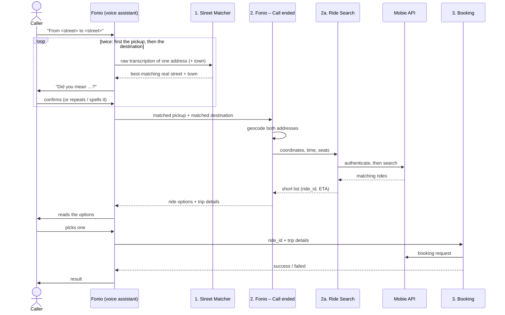
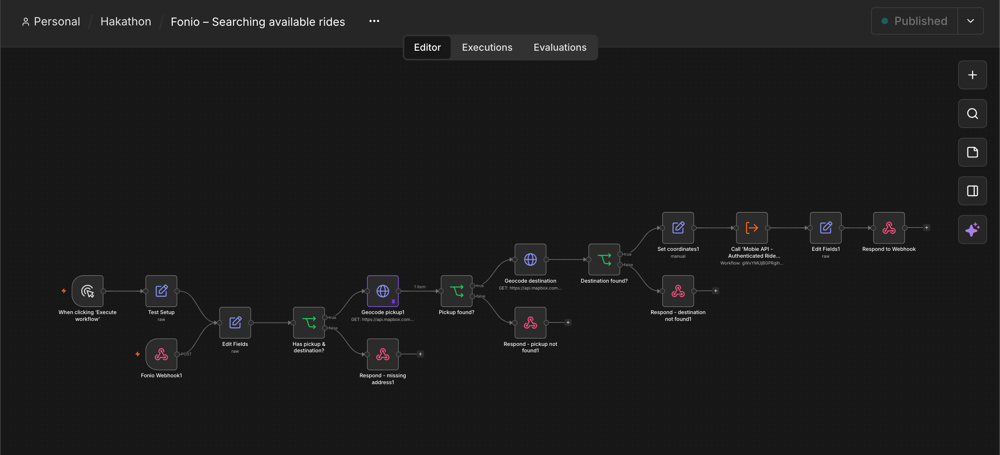

# Voice-Booked Rides: Fonio × Mobie × n8n

Phone a number, say where you are and where you want to go, and a ride request is placed for you. A voice assistant (Fonio) handles the conversation, four n8n workflows handle everything behind it, and the rides come from the Mobie ride-sharing API. No custom server code is involved.

The part we focused on is the one that makes a voice-only service fail in practice: working out which Austrian street the caller actually meant.

---

## 1. The problem

Speech-to-text systems are weakest on exactly the words a ride service depends on. Austrian street names carry local pronunciation, dialect colouring and long compound forms, and transcribers regularly split, merge or respell them into something that sounds right but isn't a real street.

For a phone assistant this is costly. A wrong street produces a wrong destination, a ride search that returns nothing or the wrong cars, and a caller who has no screen to correct anything on.

So the task is a matcher: take a noisy transcription from a phone call and map it to the most likely real Austrian street, address or point of interest. Searching and booking rides is only useful once that step is reliable.

## 2. Our idea: match first, act second

Most voice-to-API integrations pass whatever the transcriber produced straight into the next system. We do the opposite.

> **No workflow downstream of the matcher ever sees a raw transcribed address.**

The call starts in Fonio. When the caller names a street, the first thing Fonio does is send the raw transcription to a dedicated **Street Matcher** workflow, which compares how it _sounds_ against a list of known Austrian streets and returns the most likely real one. Fonio checks that match with the caller. Only the matched address is then passed to the next workflows: geocoding and ride search, and finally booking.

This gives three properties we cared about:

- **Wrong text never reaches the ride API.** Every search and booking is built from a matched street, not from whatever the transcriber produced.
- **Mistakes are caught while the caller is still on the line,** where they cost one sentence to fix instead of a failed ride.
- **Each workflow does one job,** so a problem can be traced to one place on the n8n canvas.

## 3. Architecture at a glance

The conversation always starts with the Fonio call. Behind it, four n8n workflows are published. Fonio triggers them in this order, and it calls the Street Matcher **twice per trip**: once for the pickup address and once for the destination address, each with its own confirmation.

| Order | n8n workflow                                 | Trigger                                                    | Role                                                                                              |
| ----- | -------------------------------------------- | ---------------------------------------------------------- | ------------------------------------------------------------------------------------------------- |
| 1a    | **Street Matcher (Phonetic, embedded data)** | Webhook, called by Fonio for the **pickup**                | Turns the noisy pickup transcription into the most likely real Austrian street.                   |
| 1b    | **Street Matcher (Phonetic, embedded data)** | Same webhook, called again for the **destination**         | Does the same for the destination. Runs before any other workflow sees an address.                |
| 2     | **Fonio – Call ended (pick transcript)**     | Webhook, called by Fonio once both addresses are confirmed | Takes the matched pickup and destination, converts them to coordinates and requests ride options. |
| 2a    | **Mobie API – Authenticated Ride Search**    | Sub-workflow of (2)                                        | Authenticates against Mobie and returns a short list of rides.                                    |
| 3     | **Booking**                                  | Webhook, called by Fonio                                   | Sends the booking request for the ride the caller picked. Runs last.                              |

For one ride, Fonio therefore makes **four calls to n8n**: matcher (pickup), matcher (destination), call ended, booking.



## 4. A call, step by step

1. **The caller states their trip.** Fonio transcribes it. The street names may be wrong at this point.
2. **Fonio calls the Street Matcher for the pickup** with the raw transcription, plus the town if the caller gave one. Nothing else runs yet.
3. **The matcher returns the closest real street** and the town it lies in. Fonio says it back to the caller: "Did you mean …?" If it is wrong, the caller repeats or spells the street and the matcher runs again.
4. **Fonio repeats steps 2 and 3 for the destination,** calling the same Street Matcher a second time. Each address is matched and confirmed on its own.
5. **Fonio calls "Fonio – Call ended"** with both matched addresses. The workflow checks that both are present, geocodes them to coordinates, and calls the ride search.
6. **The ride search authenticates with Mobie,** searches, and trims the response to a short list: ride id, minutes until pickup, pickup time.
7. **Fonio reads the options aloud.** The caller picks a ride.
8. **Fonio calls Booking** with the chosen `ride_id` and the trip details. A booking request is sent to Mobie and the outcome is reported back to the caller.

## 5. The workflows in detail

### 5.1 Street Matcher (Phonetic, embedded data)

The core of the project. A webhook receives the address, a Code node (`Match Street`, JavaScript, no external modules, so it runs on n8n Cloud and self-hosted alike) finds the best matches, and the result goes back to Fonio.

**Data.** The full street list from `STRASSE.csv` is embedded at the end of the script, together with the town(s) (`ZUSTELLORT`) each street lies in. There is no file upload, CSV node or database, so a lookup costs no extra network call while a caller is waiting.

**Input.** `address` (the transcribed street), and optionally `ort` (the town) and `limit` (how many matches to return, default 3). It also parses house numbers and common full-address strings.

**How a match is made**

1. **Normalise.** Lowercase, `ß` → `ss`, hyphens → spaces, and `str.` / `str` → `strasse`, so "Hauptstr." and "Hauptstraße" become the same string.
2. **Split the street type from the name.** The ending (`strasse`, `gasse`, `weg`, `platz`, `allee`, `ring`, `steig`, `zeile`, `kai`, `gassl`, and others) is separated from the stem. Common misspellings and plural forms are accepted (for example `Gabelsgassen` is read as the stem "Gabels" plus a `gasse` ending), so a garbled ending doesn't hide an otherwise correct name.
3. **Compare sounds, not spellings.** The stem is turned into a phonetic code with **Kölner Phonetik** (Cologne phonetics), which maps letters that sound alike to the same digit. Two spellings of the same sound end up with near-identical codes, which is what repairs most transcription errors.
4. **Blend two signals.** The street score is 60% phonetic similarity (of which 15% is the street-type ending) and 40% plain spelling similarity. The spelling half is the safety net when the phonetic code alone is ambiguous.
5. **Use the town to disambiguate.** Many Austrian street names exist in dozens of towns. If `ort` is given, each street is also scored on how well its best town matches, and that score counts for 30% of the final ranking. The town is matched by parts, so "Mondsee" also matches "Innerschwand/Mondsee", and "Sankt" and "St." are treated as the same. "Hauptstraße" plus "Mondsee" therefore prefers the Hauptstraße in Mondsee.
6. **Return the best matches.** Candidates are ranked by score, and anything below a minimum score of 60 is discarded rather than returned as a guess.

**Output.** Every match carries the town(s) the street really lies in: `ort` (the single matching town) and `towns` (all of them). For the top match, `bestOrt` and `bestOrte` repeat this. The webhook answers Fonio with the best match and an instruction to confirm it with the caller:

```json
{
  "success": true,
  "match": { "ort": "Graz", "address": "Grenzgasse" },
  "message": "Confirm the address"
}
```

**Confidence.** There are three safeguards:

- the minimum score (60): a weak match is dropped instead of being passed on as a guess,
- ambiguity is reported explicitly, instead of silently picking one of several close candidates,
- the caller always hears the match and confirms it before anything is searched or booked.

### 5.2 Fonio – Searching available rides

Receives the already-matched pickup and destination and turns them into ride options.



Canvas, left to right: `Fonio Webhook1` → `Edit Fields` → `Has pickup & destination?` → `Geocode pickup1` → `Pickup found?` → `Geocode destination` → `Destination found?` → `Set coordinates1` → `Call 'Mobie API – Authenticated Ride Search'` → `Edit Fields1` → `Respond to Webhook`. The `Test Setup` and manual trigger on the left run it without a call.

1. Receives `pickup`, `destination`, `pickup_time` and `passengers`.
2. Checks that both addresses are present.
3. Geocodes the pickup and the destination with Mapbox, restricted to Austria and biased toward Vienna, and checks each returned a result.
4. Assembles the coordinates and calls the ride search sub-workflow.
5. Responds to Fonio with the ride options together with all trip details, so Fonio can pass them to booking unchanged.

Every failure answers with HTTP 200 and `success: false`, an error code and a message written for the assistant to speak (`missing_address`, `pickup_not_found`, `destination_not_found`). A voice call has no error screen, so each failure is phrased as the next thing the assistant should say.

Successful response:

```json
{
  "success": true,
  "rides": [{ "ride_id": "…", "estimated_time": 4, "pickup_time": "…" }],
  "message": "pick one ride",
  "pickup": "…",
  "pickup_lat": 48.2,
  "pickup_lng": 16.3,
  "destination": "…",
  "destination_lat": 48.1,
  "destination_lng": 16.3,
  "pickup_time": "…",
  "passengers": "1"
}
```

### 5.3 Mobie API – Authenticated Ride Search

A sub-workflow, so it can be reused by any other workflow that needs rides.

1. Receives addresses, coordinates, time and seats.
2. Verifies the token with `GET /api/me`, so an expired credential fails early with a clear cause.
3. Searches with `POST /api/rides/search`.
4. A Code node trims each result to `ride_id`, `estimated_time` and `pickup_time`. It accepts the response as a bare array, `rides` or `data`, and ignores entries without a ride id. A voice assistant can read a three-field list aloud, but not the full API payload.

### 5.4 Booking

Receives the chosen `ride_id` plus the trip details from the search response and sends the booking request.

`Edit Fields1` normalises the numbers and the Vienna-time timestamp. `Book Ride` calls `POST /api/rides/{ride_id}/join-detailed` with a 30-second timeout and uses n8n's error output, so a failed call takes its own branch and returns a plain message to Fonio.

## 6. Mobie API usage

Every request carries a Bearer token stored as an n8n _HTTP Bearer Auth_ credential, plus `Content-Type: application/json` and `ngrok-skip-browser-warning: true` (the API is behind an ngrok tunnel during development).

| Purpose           | Endpoint                                  | Used in                         |
| ----------------- | ----------------------------------------- | ------------------------------- |
| Verify the token  | `GET /api/me`                             | Ride Search, before each search |
| Search rides      | `POST /api/rides/search`                  | Ride Search                     |
| Request a booking | `POST /api/rides/{ride_id}/join-detailed` | Booking                         |

Search body (booking sends the same fields plus `"confirmed": true`):

```json
{
  "departure": { "publicName": "…", "longitude": 16.37, "latitude": 48.2 },
  "destination": { "publicName": "…", "longitude": 16.35, "latitude": 48.18 },
  "time": "2026-10-15T10:00:00+02:00",
  "seatsRequested": 1
}
```

All times use the `Europe/Vienna` zone. `"now"` or an empty time becomes the current Vienna time.

## 7. Why this stack

| Component | Role | Why we chose it |
| --------- | ---- | --------------- |

| **Fonio** | Voice assistant: phone calls, speech-to-text, dialogue | It handles the telephony and conversation. It can call our webhooks at the right moment in the call, letting us put the matcher between “what was heard” and “what is used.” |
| **n8n** | Orchestration, webhooks, error handling | Each step is a visible node, so the entire call flow can be understood on one canvas and demonstrated to a jury. Webhooks, HTTP calls, sub-workflows, credential storage, and error branches are built in, so there is no server code to write, deploy, or secure. |
| **Mapbox Geocoding** | Address → coordinates | The matcher decides _which_ street; Mapbox then supplies the coordinates. Its country restriction and proximity bias keep results in Austria and near Vienna. |

## 8. Design decisions

- **Match before anything else.** Described in section 2. It is the reason the rest of the system can stay simple.
- **Two signals, not one.** Phonetic similarity repairs how a word sounds, spelling similarity guards against phonetic collisions, and the town breaks ties between identical street names.
- **Return nothing rather than a bad guess.** A score floor means an unrecognisable street leads to a question for the caller, not a wrong ride search.
- **Failures are conversation, not errors.** Each failure returns an instruction the assistant can speak, so a bad address leads to a clarifying question rather than a dropped call.
- **Booking sends a request and reports the result.** It does not wait for driver confirmation or track the ride. This keeps the call short and the logic easy to verify.
- **A failed booking is never retried automatically.** A timeout can still mean the request reached Mobie, so the workflow tells the assistant the outcome is uncertain. This prevents duplicate bookings.
- **Ride search is a separate sub-workflow.** Authentication and response shaping live in one place and can be reused.

## 9. Known limitations

- The matcher only recognises streets in its embedded dataset (`STRASSE.csv`). A street missing from it cannot be matched, and the data has to be regenerated and re-embedded when the street list changes.
- The embedded data links streets to towns but not to postcodes, so a postcode cannot be verified until a street-to-postcode mapping is added.
- Common names such as "Hauptstraße" exist in many towns. Without a town from the caller the matcher cannot tell them apart and reports the ambiguity instead of choosing.
- Cologne phonetics models standard pronunciation. When a dialect pronunciation is transcribed as something very different in sound, the match leans on the spelling-similarity part of the score, which is weaker.
- The matcher finds the most likely street, not the caller's intent. A real street that sounds similar can win, which is why the caller confirms the match.
- Points of interest are limited to what the geocoder indexes.
- Booking is request-only: no driver confirmation, cancellation or status tracking.
- The number of seats in the search is fixed rather than taken from the caller's passenger count.
- A single Mobie credential is used. Separate rider and driver accounts are not supported yet.
- The Mobie API is reached through a development ngrok URL that can change between sessions.

## 10. Setup and deployment

You need an n8n instance with a public HTTPS URL, a Mapbox token, a Mobie API token and a Fonio assistant.

1. **Import** the four workflow JSON files into n8n. Import the ride search first, so _Fonio – Call ended_ can reference it.
2. **Mobie credential.** Create an _HTTP Bearer Auth_ credential with the Mobie token and assign it to `Verify Mobie Authentication`, `Search Mobie Rides1` and `Book Ride`.
3. **Mapbox token.** Store it as an n8n credential or environment variable and reference it in the two geocoding nodes. Keep it out of any repository.
4. **API host.** Replace the ngrok URL in the three Mobie nodes with your own host.
5. **Link the sub-workflow.** In _Fonio – Call ended_, point the `Call 'Mobie API – Authenticated Ride Search'` node at the imported ride search.
6. **Time zone.** Set the instance time zone to `Europe/Vienna`.
7. **Publish** all four workflows and give Fonio the **production** webhook URLs (`/webhook/...`, not `/webhook-test/...`) for the Street Matcher, _Fonio – Call ended_ and Booking. In the Fonio assistant, the matcher is called twice (pickup, then destination) before _Fonio – Call ended_, and Booking comes last.
   **Smoke tests**

```bash
# 1. Street Matcher (Fonio calls it once for the pickup and once for the destination)
curl -X POST "$N8N_URL/webhook/<matcher-path>" \
  -H "Content-Type: application/json" \
  -d '{"address":"Grenzgasse","ort":"Graz"}'

# 2. Fonio – Call ended (geocoding and ride search)
curl -X POST "$N8N_URL/webhook/fonio-call-ended" \
  -H "Content-Type: application/json" \
  -d '{"pickup":"Muthgasse, Wien","destination":"Meidling, Wien","pickup_time":"now","passengers":"1"}'

# 3. Booking
curl -X POST "$N8N_URL/webhook/book" \
  -H "Content-Type: application/json" \
  -d '{"ride_id":"<id from search>","pickup_address":"Stephansplatz, Wien","pickup_lat":48.2082,"pickup_lng":16.3738,"destination_address":"Wien Hauptbahnhof","destination_lat":48.185,"destination_lng":16.3765,"time":"2026-10-15T10:00:00+02:00","seatsRequested":1}'
```

Inside n8n, the manual-trigger test nodes run the same flows without a phone call.
